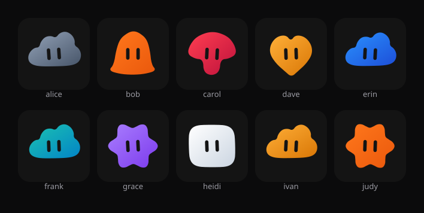

# bot-avatar

**Deterministic avatars from any string.** Same identity in, same avatar out — on every device, in every process, forever. Nothing is stored.



Ten identities, ten avatars, all computed. There is no image anywhere in this repo or in your database.

## Why

Avatars are usually files: uploaded, cropped, resized, stored, fetched, and re-uploaded when the storage moves. This library stores nothing. It hashes the identity, picks a body, a colour and an eye angle, and draws the result.

That buys four things:

- **No storage, no migration.** The avatar is a pure function of a string you already have.
- **Every client agrees.** Server, browser and mobile compute the same SVG from the same id.
- **Stable by construction.** Same pack content + same identity = byte-identical output, so responses can be cached forever.
- **Swappable looks.** The algorithm is fixed; the style lives in a pack you can replace.

## Install

Not published to npm yet. Until it is, install from this repo:

```bash
git clone https://github.com/SilasSolivagus/bot-avatar.git
cd bot-avatar && pnpm install && pnpm build
```

Then depend on the workspace packages, or copy `packages/*` into yours.

## Quickstart

```ts
import { buildAvatarSpec } from "@botavatar/engine";
import { organicBlob } from "@botavatar/pack-organic-blob";
import { renderSvg } from "@botavatar/svg";

const spec = buildAvatarSpec(organicBlob, "alice@example.com");
const svg = renderSvg(spec, { size: 96 });                    // string, drop it in the DOM
const animated = renderSvg(spec, { size: 96, state: "working" });
```

`renderSvg` returns a standalone `<svg>` string. No DOM, no globals, no framework — React, Vue, Astro and plain HTML all just insert the string.

## HTTP service

```bash
pnpm build
node apps/service/dist/cli.js --port 8787                      # built-in packs
node apps/service/dist/cli.js --pack ./my-pack.ts                # add a local pack
```

| Route | Returns |
| --- | --- |
| `GET /v1/packs` | Known packs: id, name, version, familyCount |
| `GET /v1/avatar/:identity.svg?pack=&size=&state=` | SVG, immutable-cacheable |
| `GET /v1/avatar/:identity.png?pack=&size=&state=` | PNG rasterised from the same SVG, transparent background |
| `GET /v1/avatar/:identity.json?pack=` | The `AvatarSpec` the SVG was built from |
| `GET /health` | `{ ok: true, packs: n }` |

`identity` is URL-decoded and limited to 1–200 characters; `size` is 16–1024 (default 128); `state` is `idle` or `working`.
Responses carry `ETag`, `X-Avatar-Pack` and `Cache-Control: public, max-age=31536000, immutable`.

- `ETag` is an opaque content tag — a quoted 16-hex digest over the pack's content hash,
  the identity hash, `size`, `state` and the representation kind. No pack id, version or
  identity text appears in it, so editing a pack's data invalidates cached avatars even
  when its `version` field is unchanged, and no header-breaking character can reach the
  wire. The kind marker means a PNG tag never validates an SVG entity, and vice versa.
- `X-Avatar-Pack` carries the readable `id@version` for humans in devtools and logs. It
  never affects caching: the tag alone decides.
- A request whose `If-None-Match` (a list, `*` or `W/`) matches that tag gets a bodyless
  `304`, and a hit does no rendering: no spec is built, no SVG is produced. The hit path
  is hashing only.

The service still stores nothing: a `200` recomputes and re-renders from scratch.
Logs never contain the identity, only a hash prefix.

## Gallery

The gallery is a Vite + React app that imports the library directly — no service, no fetch:

```bash
pnpm gallery        # or: pnpm --filter @botavatar/gallery dev
```

Open the printed URL (default <http://localhost:5173/>). It has a pack switcher, an identity input
with five samples, a 40-identity comparison wall with a `family · look · colour` caption per cell,
and a detail card with the spec JSON, copy/download SVG, and an idle/working toggle. **Download PNG**
is enabled only when a service base is supplied; the gallery never rasterises.

Every view is URL state, so a link reproduces it:

| Parameter | Meaning |
| --- | --- |
| `pack` | Pack id. Missing or unknown falls back to the first known pack. |
| `id` | One identity per parameter, repeated. Read verbatim (a comma or edge whitespace stays in the identity), de-duplicated and capped at 60. Missing means the pack's balanced wall of 40. |
| `ids` | Legacy comma-separated list, read only when no `id` is present. Trimmed and de-duplicated, at most 60. |
| `size` | Cell size, integer 48–512, default 160. |
| `service` | Optional `http(s)` base for the PNG link, for example `http://127.0.0.1:8787`. Not part of the wall state; it survives pack and identity changes. |

`/?pack=organic-blob&id=alice&id=bob&size=160` is a shareable view. The banner above the wall reports
**balance** — the busiest assignable look's count against `ceil(n / looks)`, with reserved looks counted
separately — and the strip below reports **distinctness**, one identity per assignable look.
[docs/m2-gallery.md](docs/m2-gallery.md) explains both, and why §12's duplicate-rate criterion was
replaced.

## What you get back

`buildAvatarSpec(pack, identity)` returns an `AvatarSpec` — everything a renderer needs, and nothing tied to SVG:

| Field | Meaning |
| --- | --- |
| `seed` | The identity hash. Non-negative, stable. |
| `family` | Which body of the pack (`0` to `shapes.length - 1`). |
| `look` | The visual family, after merging bodies a pack calls equivalent. |
| `color` | The chosen palette entry: `id`, `name`, `light`, `dark`, `eye`. |
| `path` | The body as an SVG path string, already smoothed. |
| `eyes`, `eyeRotation` | Eye geometry plus the whole group's tilt. |
| `durationMs` | The animation loop for this body. |
| `clip`, `motionAmplitude` | The loop this family plays, and the pack's amplitude for every channel. |
| `packId`, `packVersion` | Human-readable pack identity; the cache tag is derived from the pack content hash, not these. |
| `viewBox`, `surface` | Viewport, and optional material for the renderer. |

## API

**Engine** — pure functions, zero dependencies.

```ts
avatarSeed(identity: string): number
avatarFamily(seed: number, shapes: readonly ShapeFamily[]): number
avatarLook(family: number, shapes: readonly ShapeFamily[]): number
avatarAssignableLooks(shapes: readonly ShapeFamily[]): number[]
buildAvatarSpec(pack: StylePack, identity: string): AvatarSpec
avatarSampleIdentity(pack: StylePack, family: number): string
pickLeastUsed<T>(options: readonly T[], used: readonly T[], random: () => number, avoid?: readonly T[]): T
```

**Renderer** — one function, one dependency: the spec.

```ts
renderSvg(spec: AvatarSpec, options: { size: number; state?: "idle" | "working" }): string
```

## Style packs

A pack is data: shapes, a palette, eye geometry, durations, and the material the renderer may use. Writing one does not touch the engine.

```ts
import type { StylePack } from "@botavatar/engine";

export const geometric: StylePack = {
  id: "geometric",
  name: "Geometric",
  version: "1.0.0",
  viewBox: "-60 -60 120 120",
  shapes: [
    { outline: [[0, -40], [40, 0], [0, 40], [-40, 0]], smoothingPasses: 0 },
    // ...more families
  ],
  palette: [
    { id: "ink", name: "Ink", light: "#3F3F46", dark: "#18181B", eye: "#FAFAFA" },
  ],
  eyes: {
    eyes: [{ kind: "rect", x: -12, y: -10, width: 6, height: 20, rx: 3 }],
    rotation: { modulo: 9, spread: 4 },
  },
  motion: {
    durationMsByFamily: [1600],
    clipByFamily: ["breathe"],
    amplitude: 1,
  },
  assignment: "hash-only",
};
```

Three rules a pack must keep:

1. **Deterministic.** No randomness, no clocks; the pack is data and pure functions only.
2. **`outline` is a closed polygon** in the pack's `viewBox`, origin at the centre.
3. **`reserved: true`** marks bodies a new identity must never be handed (an existing hash may still land on one), and `look` merges bodies that look the same.

### Material

A pack may describe a surface instead of a flat two-stop gradient — multi-stop ink, a specular highlight, a soft shadow, grain:

```ts
surface: {
  stops: [
    { offset: 0, color: "#FFFFFF" },
    { offset: 0.45, color: "#FF9F43" },
    { offset: 1, color: "#C2410C" },
  ],
  highlight: { cx: -18, cy: -16, r: 14, opacity: 0.5 },
  shadow: { dx: 0, dy: 4, blur: 6, color: "#000000" },
  texture: { kind: "grain", opacity: 0.12 },
}
```

Everything is clipped to the body, so the avatar stays transparent outside its silhouette. `organic-blob` declares no surface and renders flat.

### Motion

A pack names one clip per family in `motion.clipByFamily`; `motion.amplitude` scales every channel.
There are eight clips — six body-level and two eye-level:

| Body | Eyes |
| --- | --- |
| `breathe`, `bob`, `sway`, `bounce`, `tilt`, `shake` | `blink`, `look-round` |

`clipFrame(clip, progress, amplitude)` is a pure keyframe function, and the renderer emits it as two
stacked CSS animations: one on the body group, one on the eyes. The clip table must have one entry
per shape; an unknown name fails at startup and the error names `motion.clipByFamily[i]`.

## Assignment

The hash decides the body, so the hash may land on a reserved family — deliberately, so identities that already exist never change their avatar.

That means nothing in the engine hands out new identities. `avatarAssignableLooks(shapes)` is the primitive: it drops reserved families and merges equivalent looks. Anything creating identities draws from that pool, for example by trying candidate ids until one lands on a look that is used least:

```ts
const looks = avatarAssignableLooks(organicBlob.shapes);
const look = pickLeastUsed(looks, looksAlreadyUsed, random);
```

`pickLeastUsed` takes the random source as an argument, so the engine itself stays deterministic and testable.

## Guarantees

| | |
| --- | --- |
| Deterministic | No `Date.now`, `Math.random`, `crypto.randomUUID` anywhere in the engine or renderer. Verified across separate processes with different `TZ`/`LANG`. |
| Stable | Same pack content + identity means byte-identical spec and SVG. |
| Dependency-free | `dependencies` and `peerDependencies` are empty in all three packages. |
| Isomorphic | ESM only; no DOM, no Node builtins. |
| Small | engine about 1.7 KB gzip, renderer about 1.5 KB gzip, pack data separate. |
| Brand-free | No upstream name appears in any source file, generated SVG, or dist. |

## Development

```bash
pnpm install
pnpm gallery     # Vite dev server for the gallery (no service needed)
pnpm test        # builds, then runs 24 files / 253 tests
pnpm parity      # replays the frozen upstream snapshot (7 tests)
pnpm typecheck
pnpm build
pnpm --filter @botavatar/gallery build
pnpm bench       # 4000 requests, concurrency 100; build first
```

`pnpm test` runs `pnpm build` first: the cross-process test imports the built packages through their `dist` entries.

`pnpm parity` is the one-time proof that this engine reproduces the renderings of the upstream project it was extracted from, at commit `a0e5781`. It is opt-in on purpose: the snapshot is frozen history, so a deliberate change to the geometry after M0 does not fail the normal suite. See `docs/parity-m0.md`.

```
apps/gallery/                  Vite + React comparison gallery (no service)
apps/service/                  HTTP service: routes, validation, caching, logging, CLI
bench/                         benchmark script for the HTTP service
packages/
  engine/                      hashing, family/look, colour, outline to path, spec, clips
  style-packs/organic-blob/    ten bodies, eleven colours, eye geometry, durations, clips
  renderer-svg/                spec to SVG string
parity/                        recorder, frozen snapshot, parity-only test
docs/                          spec, plans, benchmark, parity and M2 evidence, preview
```

## Status

**M0 — library.** Shipped: engine, the `organic-blob` pack, the SVG renderer, and the tests that pin them down.

**M1 — HTTP service.** Shipped: `apps/service`, a Hono app on Node 22 with `/v1/packs`, SVG and JSON avatar routes, `ETag`/`304` caching, redacted logging and a CLI (`--port`, `--host`, `--pack`). Every request recomputes the avatar; the M1 measured p95 was 14.3 ms at concurrency 100, see [the benchmark](docs/m1-benchmark.md) for the M1.5 figures.

**M2 — gallery, PNG and motion clips.** Shipped: the standalone Vite + React gallery in `apps/gallery` with a pack switcher, identity input, 40-identity wall, distinctness strip and detail card; `/v1/avatar/:identity.png` via `@resvg/resvg-js`, rasterised from the same SVG string; and eight motion clips chosen per family by the pack. See [docs/m2-gallery.md](docs/m2-gallery.md).

Not built yet: the M3 second style pack, and a compatibility layer for legacy stored avatar values.

## Licence

Apache-2.0. The geometry, palette and eye metrics are derived from Rakazo commit `a0e5781`; see [NOTICE](NOTICE).
